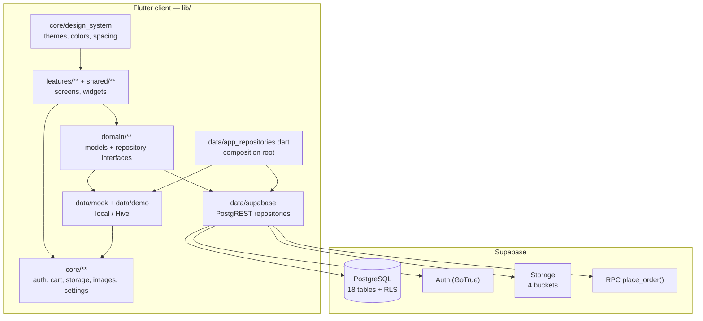
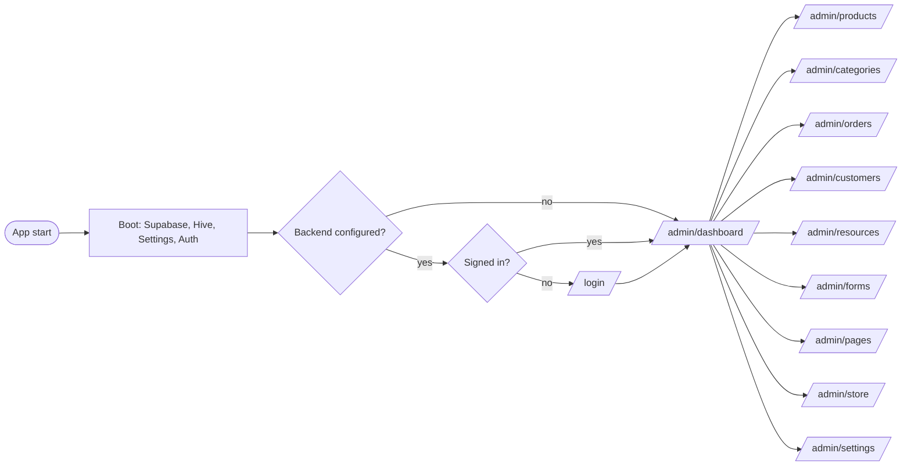
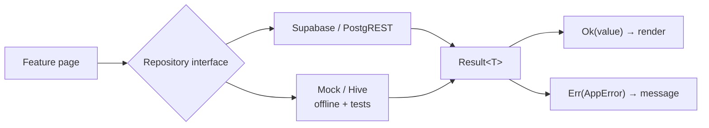
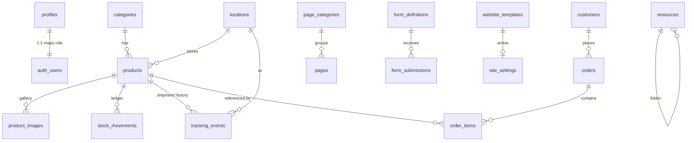

# diali — Prototype & Structure Guide / دليل النموذج والبنية

> Bilingual guide (English first, then العربية). Diagrams use English labels so
> they render consistently on GitHub. / دليل ثنائي اللغة: الإنجليزية أولاً ثم
> العربية. المخططات بالإنجليزية لضمان عرضها بشكل صحيح.

---

## 1. Overview

`diali` is a single-business commerce/admin platform: a **Flutter** client (all
platforms) with a **Supabase** (PostgreSQL + Auth + Storage) backend. It ships
with a complete **local-first** mode so the app runs offline and in tests
without any backend.

The code is split into four layers:

| Layer | Path | Responsibility |
|---|---|---|
| Presentation | `lib/features/**`, `lib/shared/**` | Screens, widgets, dialogs |
| Design system | `lib/core/design_system/**` | Theme engine, colors, spacing, typography |
| Domain | `lib/domain/**` | Models + repository **interfaces** |
| Data | `lib/data/**` | Repository **implementations** (mock/local and Supabase) |
| Infrastructure | `lib/core/**` | auth, cart, storage, images, settings, Supabase client |

### 1.1 العربية

`diali` منصّة تجارة/إدارة لنشاط تجاري واحد: تطبيق **Flutter** (على كل المنصّات)
مع خلفية **Supabase** (قاعدة بيانات PostgreSQL + مصادقة + تخزين ملفات). يعمل
التطبيق أيضاً **محلياً بالكامل** بدون أي خلفية، وهو ما يُستخدم في الاختبارات
والوضع دون اتصال.

ينقسم الكود إلى أربع طبقات: العرض (`features` + `shared`)، نظام التصميم
(`core/design_system`)، النطاق (`domain` — النماذج وواجهات المستودعات)،
والبيانات (`data` — تنفيذات المستودعات: محلية وSupabase)، إضافة إلى طبقة
البنية التحتية (`core`).

---

## 2. Architecture diagram / المخطط المعماري



Key idea: **features depend only on `domain/` interfaces**. `AppRepositories`
decides at startup whether to inject the mock or the Supabase implementations,
so no UI code changes when switching between offline and cloud.

### 2.1 العربية

الفكرة الأساسية: **الواجهات تعتمد فقط على واجهات `domain/`**. عند بدء التشغيل
يختار `AppRepositories` بين التنفيذ المحلي أو Supabase، لذلك لا حاجة لتعديل
واجهات المستخدم عند التبديل بين الوضع المحلي والسحابي.

---

## 3. Directory structure / بنية المجلدات

```
diali/
├── lib/
│   ├── main.dart                 # bootstrap: Supabase + Hive + auth + repos
│   ├── app/
│   │   ├── app.dart              # MaterialApp + theming + localization
│   │   └── router.dart           # go_router: /login, /admin/<section>
│   ├── core/
│   │   ├── app_info.dart         # version / policy metadata
│   │   ├── auth/                 # AuthController (session gate)
│   │   ├── cart/                 # CartController + scope + storage
│   │   ├── config/               # AppConfig (--dart-define only)
│   │   ├── design_system/        # theme, colors, spacing, typography, style
│   │   ├── images/               # image service + Hive-backed store
│   │   ├── navigation/           # NavSection enum (routes + labels)
│   │   ├── settings/             # SettingsController (locale, theme, style)
│   │   ├── storage/              # settings + catalog stores (Hive)
│   │   └── supabase/             # client, Result mapping, storage service
│   ├── domain/
│   │   ├── models/               # Product, Order, Customer, ...
│   │   └── repositories/         # abstract interfaces (11 repos)
│   ├── data/
│   │   ├── app_repositories.dart # composition root
│   │   ├── mock/ + demo/         # local implementations + seed data
│   │   └── supabase/             # remote implementations + mappers
│   ├── features/                 # one folder per admin section
│   ├── l10n/                     # app_ar.arb, app_fr.arb, app_en.arb
│   └── shared/widgets/           # reusable UI (tables, cards, states)
├── supabase/
│   ├── migrations/               # 6 timestamped SQL migrations
│   └── seed.sql                  # templates, site settings, app settings
├── tool/
│   ├── generate_demo_assets.dart
│   └── rls_verify/               # local RLS/security test harness
├── test/                         # widget + unit tests
└── docs/                         # architecture, schema, security, this guide
```

### 3.1 العربية

- `lib/features` : صفحة مستقلّة لكل قسم من أقسام لوحة التحكم.
- `lib/domain` : النماذج (Models) وواجهات المستودعات (Interfaces).
- `lib/data` : التنفيذات (محلية `mock` ومن السحابة `supabase`).
- `lib/core` : البنية التحتية (التصميم، المصادقة، الإعدادات، التخزين، الصور).
- `supabase/migrations` : ستّ ترحيلات SQL مرتّبة زمنياً.
- `tool/rls_verify` : أداة لاختبار سياسات RLS محلياً.
- `test` : اختبارات الواجهة والوحدة.

---

## 4. Navigation & routes / التنقّل والمسارات

The admin shell has **10 sections** (`NavSection`):



| Section | Route | Purpose |
|---|---|---|
| dashboard | `/admin/dashboard` | KPIs, quick actions |
| products | `/admin/products` | product CRUD, gallery, stock |
| categories | `/admin/categories` | product categories |
| orders | `/admin/orders` | orders + status workflow |
| customers | `/admin/customers` | customers + tiers |
| resources | `/admin/resources` | private document library |
| forms | `/admin/forms` | dynamic forms + submissions |
| pages | `/admin/pages` | CMS articles/pages |
| store | `/admin/store` | public storefront preview |
| settings | `/admin/settings` | theme, locale, account, data |

When **no backend is configured**, the login gate is disabled and
`/admin/dashboard` opens directly (offline/development mode).

### 4.1 العربية

تحتوي لوحة التحكم على **عشرة أقسام**. عند **عدم تهيئة خلفية Supabase** يتم
تعطيل بوابة تسجيل الدخول ويُفتح المسار `/admin/dashboard` مباشرةً (وضع التطوير
دون اتصال). جدول الأقسام والمسارات أعلاه يوضّح كل قسم ووظيفته.

---

## 5. Data access & error handling / الوصول للبيانات والأخطاء



- Every repository method returns `Result<T>` (sealed) instead of throwing.
- Failures are converted to a typed `AppError` (network, auth, not found, ...),
  so the UI can show a consistent, localized error state.
- Supabase repositories map rows to domain models in `supabase_mappers.dart` and
  are constructed in `AppRepositories`.
- List queries use server-side filtering, ordering and `.range()` pagination.

### 5.1 العربية

كل دالة في المستودع تُعيد `Result<T>` بدلاً من رمي الاستثناءات. تُحوّل الأخطاء
إلى `AppError` مُصنّف (شبكة، مصادقة، غير موجود...) لعرض رسالة موحّدة ومترجمة.
مستودعات Supabase تحوّل صفوف قاعدة البيانات إلى نماذج المجال عبر
`supabase_mappers.dart`، وتُستخدم الفهارس والترتيب والتقسيم (pagination) على
الخادم.

---

## 6. Database structure (ERD) / بنية قاعدة البيانات

Single business, **18 tables**, RLS enabled on every table. `auth.users` is
managed by Supabase Auth; `profiles` maps it to an application role.



Groups:

- **Identity**: `profiles` (+ `auth.users`)
- **Catalog**: `categories`, `products`, `product_images`, `locations`
- **Inventory**: `stock_movements` (append-only ledger)
- **Logistics**: `tracking_events`
- **Sales**: `customers`, `orders`, `order_items`
- **Content**: `page_categories`, `pages`, `website_templates`, `site_settings`
- **Operations**: `resources`, `form_definitions`, `form_submissions`, `app_settings`

### 6.1 العربية

قاعدة بيانات لنشاط واحد وتضم **18 جدولاً**، مع تفعيل RLS على كل جدول. جدول
`auth.users` تديره مصادقة Supabase، و`profiles` يربطه بدور التطبيق. المخطط أعلاه
يوضّح العلاقات بين المجموعات: الهوية، الكتالوج، المخزون، التوصيل، المبيعات،
المحتوى، والعمليات.

---

## 7. Security model / نموذج الأمان

Roles live in `profiles.role` (**server-side only**, never in the UI):

| Role | Read | Write |
|---|---|---|
| `anon` (public) | active products, published pages, categories, published templates/forms, site settings | submit a **published** form only |
| `viewer` | all business data | nothing |
| `staff` | all business data | products, orders, customers, resources, tracking, stock |
| `admin` | all business data | + templates, site settings, app settings |
| `owner` | all business data | everything **including role changes** |

- RLS is **default-deny**; private tables (`customers`, `orders`, `order_items`,
  `locations`, `stock_movements`, `tracking_events`, `resources`,
  `app_settings`, `profiles`) are **not** readable by `anon`.
- Storage buckets: `products`, `site`, `avatars` (public read) and `resources`
  (**private**, signed URLs only); size + MIME enforced at the bucket.
- Money is `numeric(12,2)` and non-negative; `order_items.qty > 0`; unique on
  `sku`, `slug`, `order_number`, `email`.
- `place_order(p_order, p_items)` runs as one transaction (order + items +
  stock) and validates its input server-side.
- The **service-role key never ships** to the client; only the anon key via
  `--dart-define`.

Verified by `tool/rls_verify/run.sh` (74 assertions on local PostgreSQL).
Full detail: `docs/security-review.md`.

### 7.1 العربية

الأدوار محفوظة في `profiles.role` وتُفرَض **على الخادم فقط** وليس بإخفاء
الأزرار. RLS مفعّل بنمط **المنع الافتراضي**، والجداول الخاصة لا يقرأها `anon`.
الملفات: الحاويات العامة للقراءة (`products`, `site`, `avatars`) والحاوية
الخاصة `resources` تُقدَّم عبر روابط موقّعة فقط، مع تقييد الحجم والنوع على مستوى
الحاوية. المبالغ المالية `numeric(12,2)` وغير سالبة، والكمية `> 0`، مع قيود
الفرادة على الحقول الأساسية. مفتاح `service_role` لا يُرسَل إلى العميل أبداً.

---

## 8. Theming & localization / التصميم والترجمة

- **3 themes** via `AppStyle`: `modern`, `minimal`, `professional` — each with
  light/dark modes, colors, corner style, density, shadows, font size.
- **3 locales**: Arabic (`ar`, RTL), French (`fr`), English (`en`) — generated
  from `lib/l10n/*.arb`.
- Preferences (locale, theme, style) persist through `SettingsController`.

### 8.1 العربية

ثلاثة أنماط تصميم (`modern`, `minimal`, `professional`) لكل منها وضع فاتح وداكن،
وثلاث لغات: العربية (من اليمين إلى اليسار)، الفرنسية، والإنجليزية. تُحفَظ
التفضيلات (اللغة، السمة، النمط) عبر `SettingsController`.

---

## 9. How to run & verify / التشغيل والتحقّق

```bash
# Local-only (offline / mock data)
flutter pub get
flutter run -d linux

# Against a real backend (secrets injected at build time; never committed)
flutter run -d linux \
  --dart-define=SUPABASE_URL=https://<ref>.supabase.co \
  --dart-define=SUPABASE_ANON_KEY=<anon-key> \
  --dart-define=APP_ENV=production

# Quality gates
flutter analyze
flutter test

# RLS / security assertions (needs local PostgreSQL binaries)
tool/rls_verify/run.sh
```

Apply the database schema (choose one):

```bash
supabase db push                 # CLI linked to a project
# or: run supabase/migrations/*.sql in filename order, then supabase/seed.sql
```

### 9.1 العربية

- التشغيل المحلي: `flutter run -d linux` (يعمل ببيانات تجريبية دون خلفية).
- التشغيل مع خلفية Supabase: مرّر القيم عبر `--dart-define` (لا تُخزَّن في
  المستودع أبداً).
- فحوصات الجودة: `flutter analyze` و`flutter test`.
- اختبارات RLS: `tool/rls_verify/run.sh` (يتطلب PostgreSQL محلياً).
- تطبيق المخطّط: عبر `supabase db push` أو تشغيل ملفات الترحيل بالترتيب ثم
  `seed.sql`.

---

## 10. Status & limitations / الحالة والحدود

- Frontend + local data layer: complete; app builds and runs on Linux, web,
  Android, iOS, desktop.
- Backend schema, RLS, storage and RPC: written and verified **against a local
  PostgreSQL with a Supabase-compatible shim** (`tool/rls_verify`).
- **Not yet verified against a live Supabase project**: GoTrue/PostgREST JWT
  wiring, Storage API + signed URLs, and `service_role` behaviour end-to-end.
- Public form submission has no rate limiting/CAPTCHA yet.

### 10.1 العربية

- الواجهة وطبقة البيانات المحلية مكتملتان، ويعمل التطبيق على لينكس والويب
  وأندرويد وiOS.
- المخطّط وRLS والتخزين ودالة `place_order` مكتوبة ومُختبَرة محلياً عبر محاكي
  Supabase (`tool/rls_verify`).
- **لم تُختبر بعد على مشروع Supabase حقيقي**: ربط JWT، واجهة التخزين والروابط
  الموقّعة، وسلوك `service_role` بشكل كامل.
- لا يوجد تقييد معدّل أو CAPTCHA لنماذج الإدخال العامة بعد.
